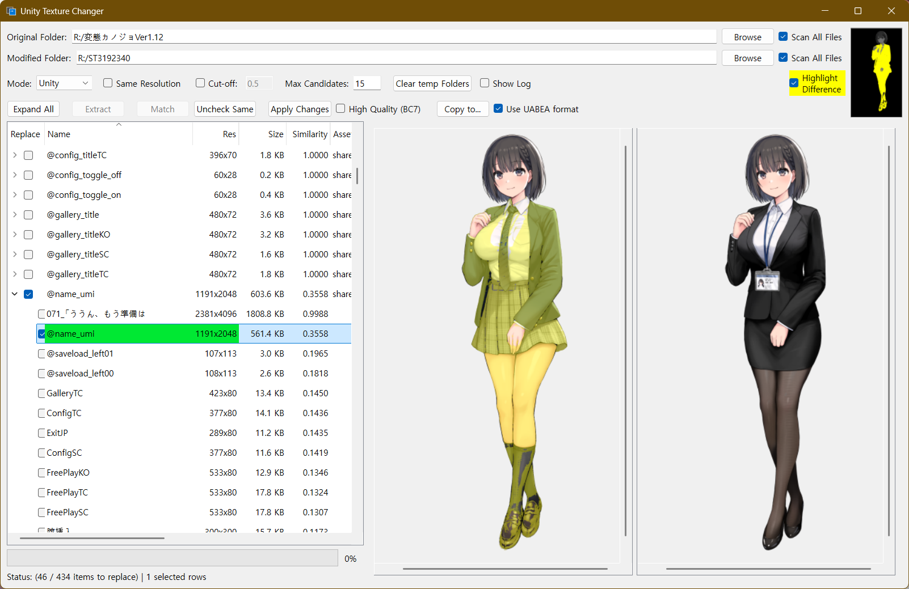

[English](./README.md) | [한국어](./README_ko.md)

# Unity Texture Changer



A sophisticated GUI tool designed to intelligently compare and replace textures within Unity assets, APK files, or standard image folders. It leverages Perceptual Hashing and Structural Similarity algorithms to automate the matching process between original and modified versions.

## Download

Prebuilt Windows executable: [latest release](https://github.com/trimmerpop/Unity-Texture-Changer/releases/latest)
(`UnityTextureChanger.exe`, single file - put `uber-apk-signer.jar` next to it if you need APK repacking).

## Key Features

- **Multiple Mode Support**:
  - **Unity**: Directly extract and replace textures from installed Unity game folders.
  - **Unity APK**: Decompile APKs, modify textures, and perform repackaging/signing.
  - **Image**: Support for 1:1 file matching and overwriting between standard image folders.
- **Intelligent Matching**:
  - Fast candidate search using Hamming Distance.
  - Precision similarity analysis based on MSE (Mean Squared Error).
  - Name-based matching (logic to ignore Unity's `_PathID` suffixes) and resolution filtering.
- **Advanced Viewer**:
  - Synchronized scrolling and zooming for side-by-side comparison.
  - Difference Highlight feature to detect subtle pixel changes.
- **Unity Engine Optimizations**:
  - Manual decoding for non-standard headers (e.g., Unity 2021.3.45).
  - Automatic patching of Addressables `catalog.json` (CRC/Size/MD5) to prevent game freezes.
  - Support for high-quality BC7 compression forcing.
- **Atlas Aware Matching** (see [Atlas Support](#atlas-support)):
  - `.atlas` files, Unity sprite atlases (`Sprite`/`SpriteAtlas`) and Spine atlases shipped as Unity `TextAsset`s are compared **per page**, piece by piece.
  - One item per page image - individual sprites never become rows.
  - Similarity = *same pieces / all pieces*, shown in a dedicated **Atlas** column (numeric sort).
  - Apply writes **only the changed pieces** into the original layout, so the original packing stays intact.
  - Piece alignment keeps the **original resolution** and offsets, and padding stays transparent.
- **Quality of Life**:
  - Matching results, checkboxes and previews survive a restart.
  - The thumbnail's viewport frame is drawn in magenta with a dark halo, so it stays visible on the grayscale/yellow difference image.

## Requirements
- You may need a lot of storage for your studies involving the extraction of asset files.

### Prerequisites
- Python 3.10+
- **(For APK Mode)** Java Runtime Environment (JRE) or JDK installed and added to PATH.

### Library Installation
```bash
pip install PyQt6 UnityPy Pillow opencv-python numpy packaging
```

### Additional Files
- To use the APK repacking feature, download `uber-apk-signer.jar` from [uber-apk-signer (GitHub)](https://github.com/patrickfav/uber-apk-signer) and place it in the same directory as the executable or `main.py`.

## Usage

1. **Set Paths**: Enter the path to the original game/images in 'Original Folder' and your modified images in 'Modified Folder'. (Supports Drag & Drop)
2. **Select Mode**: Choose the appropriate mode (Unity, APK, or Image).
3. **Extract**: For Unity/APK modes, extract textures from the assets. Previous sessions will be auto-loaded if available. Keep **Check Atlas** enabled to pick up atlas pages (see below).
4. **Match**: Click 'Match' to automatically find the best candidates based on visual similarity.
5. **Review**: Select items in the list to compare them side-by-side and confirm the replacement candidates. The **Atlas** column shows how much of an atlas page is unchanged.
6. **Apply**: Click 'Apply Changes' to patch the assets or overwrite original files. (APK mode generates a new signed APK).

## Atlas Support

Packed sprites are compared and replaced **per piece**, but an item is always a **page image**,
never a single sprite. Three sources are recognized:

| Source | What becomes a page item | How the pieces are known |
| --- | --- | --- |
| Image mode (`*.atlas` next to the PNGs) | every page of the `.atlas` file (`hero.png`, `hero_2.png`, ...) | the `.atlas` text (bounds / rotate / offsets) |
| Unity sprite atlas | every `Texture2D` that `Sprite` objects point at | `Sprite.m_RD` / `SpriteAtlas.m_RenderDataMap` rects |
| Spine atlas inside a Unity build | every page `Texture2D` of the atlas | the `TextAsset` `.atlas` (dumped next to the extraction and parsed) |

How it behaves:

- **Similarity**: `same pieces / all pieces` of that page. A piece counts as the same when its
  trimmed pixels match (a small tolerance absorbs re-encode noise, real edits are always
  counted as changed). Texture IDs (`_12345`) are ignored for Unity pages, the texture name is
  the identity.
- **Atlas column**: percentage plus `(same/total)`, colored blue for page comparisons, sortable
  numerically. The tooltip names the page, e.g. `page 2/3 (hina_cg1_2.png) of hina_cg1.atlas`.
- **Apply**: only the changed pieces are composited into the original page, at the original
  rect/rotation. Unchanged pieces keep their exact pixels, so the original packing is preserved.
  For Unity pages the composited texture is pushed back through the normal texture replacement
  (BC7/format options still apply), before the APK is repacked.
- **Alignment**: the original resolution wins. If the modified build trimmed a sprite a little
  differently or shifted its offset, the art is scaled by the ratio of the untrimmed sprite
  sizes (usually 1.0, so no resampling), centered on the original piece, and the rest of the
  region stays transparent - transparent art stays transparent.
- **Copy to**: for an atlas page the exported file is the **assembled page at the original
  resolution** (the item itself only holds a small preview), so the image can be used directly.
- **Highlight Difference**: with the toggle on, the right panel shows the mod art **assembled
  into the original layout** (exactly what Apply would write), so the yellow marks only real
  art changes instead of the whole re-packed sheet. With the toggle off the raw modified page
  is compared.

Notes:

- Multi-page atlases (e.g. `hina_cg1`, `hina_cg1_2`, `hina_cg1_3`) produce **one row per page**
  because every page is a separate image on disk.
- Extractions made by an older version (per-piece or merged atlas rows) are detected and
  re-extracted automatically. If you updated the tool, run **Extract** once with
  `Check Atlas` enabled.
- Spine `.json` skeletons inside Unity are only reported in the log - their page rects are not
  used.


## Building the Executable

You can create a standalone `.exe` using the provided build script:

```bash
python build_exe.py
```
The output will be located in the `dist` folder.

## UI Overview

### 1. File & Directory Selection
*   **Original Folder**: The directory path containing the original game files or Unity assets.
*   **Modified Folder**: The directory path containing your edited or modified textures that you want to replace the originals with.
*   **Browse (Buttons)**: Opens a file explorer window to let you select the respective folders.
*   **Scan All Files (Checkboxes)**: When checked, the application will search for files recursively through all subdirectories within the selected folders.

### 2. Matching Settings & Options
*   **Mode (Dropdown)**: Selects the operation mode depending on the target format (e.g., Unity project, APK, standard images).
*   **Same Resolution**: If checked, the tool will only suggest modified textures that have the exact same resolution as the original texture.
*   **Check Atlas**: Turns atlas handling on/off. When on, `.atlas` pages, Unity sprite atlases and Spine atlases inside Unity assets become page items with piece-level comparison (see [Atlas Support](#atlas-support)). When off, the page images are treated like ordinary images.
*   **Cut-off**: The minimum similarity threshold (currently 0.5). The tool will ignore potential matches that have a similarity score lower than this value.
*   **Max Candidates**: Limits the maximum number of potential matching images shown for each original texture (currently set to 15).
*   **Clear temp Folders**: Deletes temporary files generated by the application during extraction or processing.
*   **Show Log**: Toggles a console window displaying detailed process logs and errors.

### 3. Action Buttons
*   **Expand All**: Expands all the collapsed folders or nested items in the left-hand list view.
*   **Extract**: Extracts accessible textures from the Unity assets located in the "Original Folder".
*   **Match**: Compares the extracted original textures with the images in the "Modified Folder" and pairs them up based on visual similarity.
*   **Uncheck Same**: Automatically deselects items in the list where the original and modified textures are identical (meaning no replacement is necessary).
*   **Apply Changes**: Executes the actual texture replacement, packing the selected modified textures back into the game files.
*   **High Quality (BC7)**: Forces the tool to use BC7 compression when packing textures, offering higher quality.
*   **Copy to...**: Allows you to save or export the newly modified game files to a specific destination folder instead of overwriting the originals directly.
*   **Use UABEA format**: Tells the tool to utilize the UABEA (Unity Asset Bundle Extractor Avalon) logic/format for processing the assets.

### 4. UI Elements & Previews
*   **Highlight Difference**: A toggle (highlighted in yellow when active) that visually highlights the differences between the original and the modified texture in the preview panels. For atlas pages it compares against the mod art **assembled into the original layout** (see [Atlas Support](#atlas-support)).
*   **Left Panel (List View)**: A detailed list showing the original textures, their matched candidates, resolution, file size, similarity score and the **Atlas** column. The checkboxes let you choose which files to actually replace.
*   **Atlas Column**: For atlas pages, `same pieces / all pieces` as a percentage, e.g. `95.3% (61/64)`. Blue text, numeric sorting; the tooltip lists the page and shows which pieces changed, moved, rotated or were re-trimmed.
*   **Center Preview Panel**: Displays the currently selected original texture (with the yellow difference marks when Highlight Difference is on). The small thumbnail on the top right shows the whole image and a magenta frame marking the visible area.
*   **Right Preview Panel**: Displays the modified texture that is selected as a candidate to replace the original. Atlas pages show the assembled result when Highlight Difference is on.
*   **Status Bar (Bottom)**: Shows the current state of the application, such as how many items are queued for replacement out of the total, and how many rows are currently selected.

## Hotkeys & Controls

### List (Results)
- **`Space`**: Toggle the 'Replace' checkbox for selected items. (Always checks sub-items).
- **`Delete`**: Remove selected original or candidate items from the list.
- **`+` (or `=`)**: Check all items for replacement.
- **`-`**: Uncheck all items.
- **`*` (Asterisk)**: Inverse all selection states.

### Comparison Viewer
- **`Mouse Wheel`**: Zoom in/out relative to the mouse pointer.
- **`Left Drag`**: Pan/Scroll images.
- **`Top Right Thumbnail Click`**: Jump to the clicked position on the texture.

### Paths
- **`Double Click`**: Open folder selection dialog.
- **`Drag & Drop`**: Drop folders or APK files directly onto the input fields.

## Important Notes

- **Backup**: 'Apply Changes' modifies original files. Always create a backup before proceeding.
- **Atlas pages**: Apply only rewrites the changed pieces of the original page (the layout is kept), but the asset file is still modified - back up the original assets first.
- **APK Signing**: Modded APKs are signed with a debug key. You may need to uninstall the original app before installing the modded version.

## License
This tool is for personal use and utilizes the `UnityPy` library for asset manipulation.